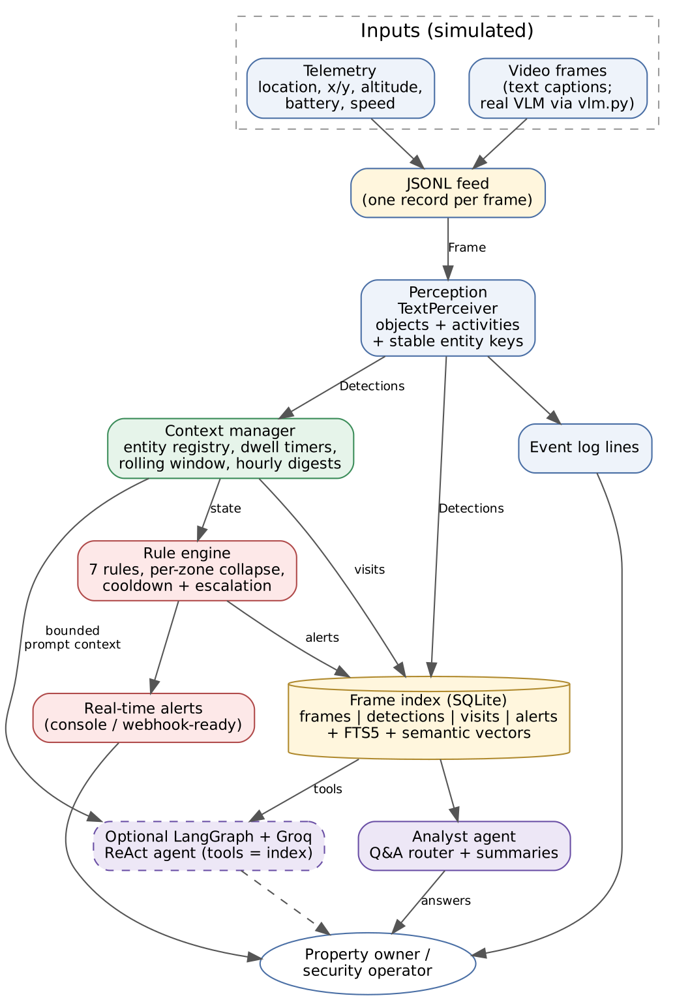

# Drone Security Analyst Agent

Prototype for a docked drone that patrols a fixed property: it ingests **telemetry + video-frame
descriptions**, **logs objects/events with context**, raises **real-time alerts** from predefined
rules, and **indexes every frame** so it can be queried by time, object, location or free text.
Bonus features included: **video summarisation** and **follow-up Q&A**.

```
Blue Ford F150 spotted at garage, 12:00.
[HIGH] Person loitering at Main Gate, 00:01.
> show all truck events      -> 9 frames, 07:45 ... 23:30
> how many times did the blue truck enter?  -> entered 3 time(s): 07:45-08:30, 11:58-12:40, 19:00
```

* Python 3.10+, **no third-party dependencies for the core** (stdlib + SQLite/FTS5).
* 46 automated tests, ~1 s. Tested at 50,000 frames (see *Scalability*).
* Optional LangGraph/LangChain + Groq agent and a real-video (BLIP) bridge.

Latest local test and 50/100/500-frame benchmark results, real-video Q&A scope, and remaining
submission tasks are recorded in [`docs/assignment_validation.md`](docs/assignment_validation.md).

---

## 1. Quick start

```bash
git clone <your-private-repo> && cd drone-security-analyst
python -m venv .venv && source .venv/bin/activate      # Windows: .venv\Scripts\activate
pip install pytest                                      # only needed for tests

python -m drone_analyst simulate        # writes data/sample_feed.jsonl  (30 frames, one simulated day)
python -m drone_analyst run             # processes the feed live: logs, alerts, summary -> output/drone.db
python -m drone_analyst chat            # ask follow-up questions (blank line to quit)
python -m pytest -q                     # 46 tests
```

The persistence test uses a unique temporary directory inside `output/`, so it does not rely on
pytest's default Windows temp directory. A cache permission warning from `.pytest_cache` may still
appear; it does not fail the tests.

```powershell
python -m pytest -v
```

`make demo`, `make test`, `make scale` are shortcuts for the above.

### CLI reference

| Command | What it does |
|---|---|
| `simulate [--date --seed --out]` | Generate the simulated telemetry + frame-caption feed (JSONL) |
| `run [--feed --db --delay 0.3 --quiet]` | Stream the feed through the pipeline. `--delay` makes it play "live" |
| `ask "question"` / `chat` | Follow-up questions answered from the index (works on a saved DB) |
| `summary` | One-sentence + structured summary of the monitored period |
| `query --object truck --location garage --start 00:00 --end 05:00` | Direct index query |

Example questions the agent understands: *"show all truck events"*, *"how many times did the blue
truck enter?"*, *"what objects were in the video?"*, *"any critical alerts?"*, *"anything suspicious
at night?"*, *"what happened between 00:00 and 01:00?"*, *"when was the last time a person was at
the gate?"*, *"what happened at the garage?"*, and free text ("someone trying to break in") which
falls back to similarity search.

### Optional extras

```bash
pip install langchain-core langgraph langchain-groq
export GROQ_API_KEY=...                  # https://console.groq.com
python - <<'PY'
from drone_analyst.agent import SecurityAnalystAgent
from drone_analyst.simulator import build_frames
from drone_analyst.llm_agent import ask_llm
a = SecurityAnalystAgent(); a.ingest_many(build_frames())
print(ask_llm(a, "Summarise tonight's risks and what a guard should check first."))
PY

# real video -> captions (downloads a BLIP model on first run)
pip install opencv-python transformers torch pillow
python -m drone_analyst.vlm my_clip.mp4 --out data/real_feed.jsonl --every 2
python -m drone_analyst run --feed data/real_feed.jsonl
```

> The LLM tools are unit-tested without a key (`tests/test_llm_tools.py`); a live Groq call has not
> been validated. The BLIP bridge was run on the supplied city-traffic video using cached model
> weights. Its captions missed some small or scene-level details, so the reviewed demo database
> includes clearly documented manual annotations. See `docs/assignment_validation.md` before
> presenting real-video results as detections.

### Rebuild the PDF report

```powershell
pip install reportlab pillow
python scripts/make_report.py
```

The generated report still needs the real private-repository URL, demo-video links, and an
AI-tools description confirmed by the candidate before it is ready to submit.

---

## 2. Feature spec

**Value to property owners:** automated, always-on monitoring that turns hours of drone footage into
a short list of *things that matter* — instant alerts for suspicious behaviour, plus a searchable
history ("when did that truck come?") instead of scrubbing video.

**Key requirements**

1. **R1 – Ingest & log:** process telemetry + frames in order and log each object/activity with time and place.
2. **R2 – Real-time alerts:** raise severity-ranked alerts from configurable rules (night loitering, unknown vehicle after hours, intrusion behaviour, restricted zones, repeat visitors, drone health/geofence) without flooding the operator.
3. **R3 – Queryable memory:** every frame stored with timestamp, telemetry and structured detections; queryable by time, object, location and text; operators can ask follow-up questions and get a summary.

Full spec: [`docs/feature_spec.md`](docs/feature_spec.md).

---

## 3. Architecture & design decisions



Per-frame flow ([`docs/pipeline.png`](docs/pipeline.png)): **perceive → update context → index → run rules → collapse/cooldown → alert**.
Data model: [`docs/data_model.png`](docs/data_model.png). Longer write-up: [`docs/architecture.md`](docs/architecture.md).

| Module | Responsibility |
|---|---|
| `models.py`, `config.py` | Dataclasses; every tunable threshold (night hours, dwell time, zones, allow-list, battery, geofence) |
| `simulator.py` | Scripted day with telemetry (waypoint-based) and frame captions, incl. injected anomalies |
| `perception.py` | Caption → `Detection` (kind, category, stable entity key, activity, count). `Perceiver` protocol = seam for a real VLM |
| `context.py` | **Context management**: entity registry, dwell timers, visit enter/exit tracking, rolling window, hourly digests, bounded LLM prompt snapshot |
| `rules.py` | 7 rule classes + `RuleEngine` (collapse per entity/zone, cooldown with escalation) |
| `indexer.py` + `semantic.py` | **Frame-by-frame index**: SQLite tables, FTS5 full-text, dependency-free semantic vectors |
| `agent.py` | Pipeline orchestration, deterministic Q&A router, summarisation |
| `llm_agent.py` | Optional LangGraph ReAct agent whose tools are the index |
| `vlm.py` | Optional real-video → BLIP captions → same JSONL schema |

**Key decisions and why**

* **Text captions as the VLM stand-in** (explicitly allowed by the brief) so correctness is testable and deterministic; `Perceiver` keeps the real-VLM path open.
* **Stable entity keys** (`blue ford f150`, `plate:mh12xy9999`, `person:dark hoodie`) are what make cross-frame reasoning possible: "entered twice today" and loitering dwell time both hang off them.
* **Visit tracking** (enter → exit) rather than counting sightings, because a parked truck seen in five frames is one visit, not five.
* **Alert hygiene**: per-(entity, zone) collapse to the most severe rule, then a 15-min cooldown that only lets *escalations* through (MEDIUM → HIGH). Without this, one loiterer produces an alert per frame.
* **SQLite + FTS5** as the index: zero-ops, ACID, indexed by time/location/category, and the same file is the QA source of truth so `ask` works after the process exits.
* **Deterministic Q&A first, LLM optional**: answers are grounded and reproducible offline; the LLM layer adds free-form reasoning on top using the *same* index as tools.
* **Bounded context**: the registry grows with distinct objects, not frames; older frames compress into hourly digests; the LLM snapshot is capped (3 000 chars) and trims the entity table first so fresh information is never cut.

---

## 4. Testing

`python -m pytest -q` → **46 passed**. Coverage by area (details in [`docs/testing.md`](docs/testing.md)):

* **Perception** (13): truck logged correctly under different wordings, clothing descriptors, negation ("no one exits"), plates, counts, courier "leaves package" ≠ exit, driver "exits vehicle" ≠ vehicle exit.
* **Rules/alerts** (15): midnight loiterer → HIGH exactly as in the brief; same behaviour by day → MEDIUM; dwell-based loitering and timer reset; unknown vs resident vehicle at night; vehicle leaving not flagged; repeat-visit alert and next-day reset; climbing beats restricted-zone (collapse); cooldown suppression vs escalation; battery/altitude/geofence; healthy telemetry is silent.
* **Index & Q&A** (16): sample log/alert strings, queries by object / time / wrap-around night window / location / combined, FTS and semantic search, visit tracking, all question types, bounded context, persistence round-trip.
* **LLM tools** (2): tools return grounded data; missing API key fails loudly.

**Dynamic input / emergency scenarios** in the simulated day: intrusion sequence (fence climb with ladder → run → tamper with back door, 16:20–16:22, CRITICAL), after-hours unknown SUV, midnight loiterer, drone geofence breach + altitude excursion + low battery.

---

## 5. Scalability

`python scripts/scalability_test.py --frames 50000` (measured in the generation environment; yours will differ):

| Metric | Result |
|---|---|
| Ingest throughput (full pipeline incl. DB writes) | **~4,800 frames/s** (50,000 frames in 10.4 s) |
| DB size | 17.6 MB for 50k frames |
| Peak RSS | 211 MB (dominated by the in-memory semantic index) |
| LLM context size | flat at ~3 000 chars from frame 10k to 50k |
| Object query ("truck", 4,397 rows) | 40 ms |
| Time-of-day query (22:00–05:00, 14k rows) | 51 ms |
| Full-text search | 2 ms |
| Follow-up Q&A ("how many times did the truck enter") | 5.5 ms |
| Semantic search (brute force) | **178 ms — linear in frames; the first thing to replace with an ANN index at scale** |

Honest caveat: these are *text-caption* frames; a real VLM (hundreds of ms per frame) would be the bottleneck, not this pipeline.

---

## 6. AI tools used and their impact

See [`docs/ai_tools_log.md`](docs/ai_tools_log.md) (edit this to reflect your own workflow before submitting).
Summary: **Claude** generated the first draft of the architecture, rule set, perception lexicon, SQLite
schema, tests and docs; iterations were driven by running the tests and the scalability script and
fixing the failures they exposed (e.g. non-deterministic semantic hashing, `F-150` tokenisation,
"leaves package" misread as an exit).

## 7. Limitations / next steps

* Perception is lexicon-based: it handles the caption vocabulary in `perception.py`, not arbitrary VLM prose. Production: constrain the VLM to a JSON schema (or use an LLM extraction step) and keep the rule engine unchanged.
* Entity identity is by description, not appearance; two different people in "dark hoodie" merge. Production: re-ID embeddings / plate OCR.
* Semantic index is a hashed bag-of-words with synonyms (retrieval is decent on the sample queries, weak on short captions with generic words); swap for CLIP/sentence-transformers + Chroma/Qdrant.
* Alerts print to console; wiring to webhook/SMS/Slack is a ~10-line sink.
* Not done: multi-drone support, per-day summaries across many days, clip extraction around alerts, evaluation on real footage.

## 8. Submission checklist (from the brief)

- [ ] Private GitHub repo, add **assignments@flytbase.com** as contributor
- [ ] Record screen videos **with voiceover** — script in [`docs/demo_script.md`](docs/demo_script.md)
- [ ] Export `report/Drone_Security_Analyst_Report.pdf`, personalise the "AI tools" section
- [ ] Email repo link + video links (view access enabled)
