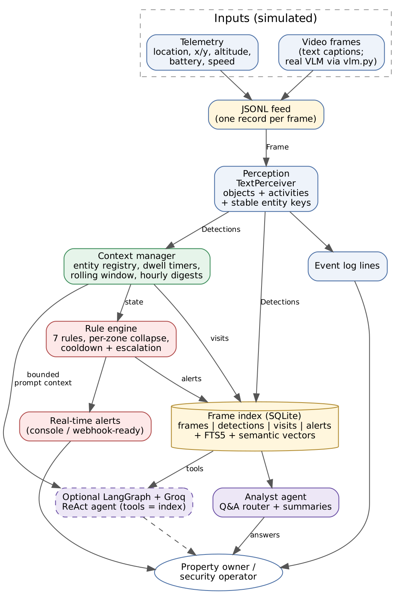
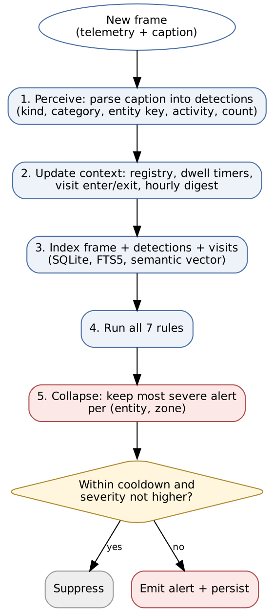
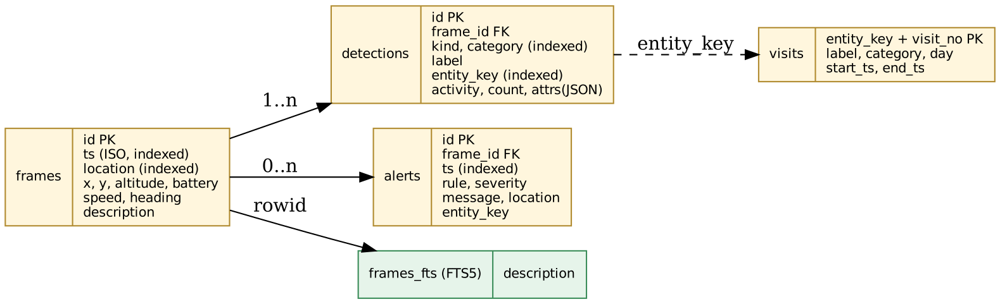

# Architecture

## Data flow
1. **Feed** - JSONL, one record per frame: timestamp, telemetry (`location, x, y, altitude_m, battery_pct, speed, heading`) and a caption.
2. **Perception** (`perception.py`) - splits the caption into clauses, drops negations ("no one exits"), finds vehicle phrases (colour + make/model/type), people (role, clothing descriptor, count), animals, suspicious objects, and the dominant activity per clause (priority order: tampering > climbing > running > loitering > entering > exiting > ...). Each detection gets a **stable entity key**.
3. **Context** (`context.py`) - updates the entity registry, per-(entity, zone) presence timers, vehicle visit state (enter/exit), a rolling window and hourly digests.
4. **Index** (`indexer.py`) - writes frame + detections (+ visits, alerts) to SQLite, FTS5 and the semantic vector index.
5. **Rules** (`rules.py`) - seven rules produce candidate alerts. `RuleEngine` collapses candidates per (entity, zone) to the most severe and applies a cooldown that lets only escalations through.
6. **Agent** (`agent.py`) - Q&A router and summariser read the index; `llm_agent.py` exposes the same index to an LLM as tools.

## Rules
| Rule | Trigger | Severity |
|---|---|---|
| loitering | "loitering" caption, or same person in same zone >= 3 min | HIGH at night, MEDIUM by day |
| night_presence | any person during 22:00-05:00 | MEDIUM |
| unknown_vehicle_night | non-resident vehicle at night (not when leaving; plate-identified vehicles excluded) | HIGH |
| suspicious_activity | climbing / tampering | CRITICAL |
| | running | HIGH night / MEDIUM day |
| | suspicious object (ladder, crowbar, ...) | HIGH |
| restricted_zone | person/vehicle in a restricted zone (Perimeter Fence) | HIGH |
| repeat_vehicle | vehicle's Nth entry today >= threshold (2) | LOW |
| telemetry | battery < 20% / < 10%; altitude > 60 m or < 2 m; outside geofence | MEDIUM/CRITICAL; MEDIUM; HIGH |

## Context management and scale
* Registry size = number of **distinct objects**, not frames. Per-entity daily counters and hourly digests are pruned to 7 days; the DB keeps everything.
* LLM context = `prompt_context()`: drone state, on-site entities, recent alerts, last 8 frames, then as many entity rows as fit in 3 000 chars (entities are trimmed first).
* SQLite indexes on `frames(ts)`, `frames(location)`, `detections(entity_key)`, `detections(category)`, `alerts(ts)`.

## Where a real VLM plugs in
`Perceiver.perceive(frame) -> list[Detection]` is the only contract. `vlm.py` captions real video with BLIP and feeds the same text path; a stronger option is a VLM prompted for JSON detections (object, colour, make, activity) so the lexicon parser is bypassed while the context/rules/index stay untouched.

## Known limits
Description-based identity (no re-ID), lexicon vocabulary, brute-force semantic search (linear), single-process.
